# SagaApp（圣人双机服务端）

采集卡取帧 → YOLO 推理 → Makcu 串口鼠标控制的 Windows 桌面程序。
它是易语言原版「圣人自用 / 圣人双机」的 C++ 翻写版：界面、配置项、数值语义都对齐易语言原版，
但把原版依赖的 `Saga.dll`（采集 + NCNN/ONNX + 串口）源码直接编进了 EXE，**运行时不再需要 Saga.dll**。

- 工程：`Saga.sln` 包含 `SagaApp.vcxproj`（主程序）与 `TrtConverter.vcxproj`（ONNX 转换工具）/ 源码：`src\`
- 目标：**x64 Release**（工程只配了 x64，没有 Win32 配置）
- 产物：`x64\Release\圣人双机服务端.exe`（TargetName 已改名，不是 SagaApp.exe）
- 转换工具：`x64\Release\ONNX转TRT工具.exe`；模型及输出 `.trt` 不随源码入库
- 许可：本项目主体 **GPL-3.0**（`LICENSE`）；第三方代码与数据见 `THIRD-PARTY-NOTICES.md`

支持的模型：

- **NCNN 框架**：YOLOv11。
- **ONNX 框架**：YOLOv5、v6、v7、v8、v9、v10、v11、v12、v26，以及 [**YOLOE**](https://github.com/Geekgineer/YOLOs-CPP/blob/main/docs/guides/models.md#yoloe-open-vocabulary-detection-segmentation)（open-vocab，开放词汇）。
- **TRT 框架**：YOLOv8、YOLOv11 的标准目标检测导出；要求单个 RGB 输入 `[1,3,H,W]` 和单个原始检测输出 `[1,4+类别数,候选框数]`。不支持带 objectness 的旧版输出、内置 NMS、分割、姿态及 YOLOE 开放词汇接口；其他版本不能保证兼容。详见 [TensorRT 支持范围](docs/TensorRT使用说明.md#支持范围与依赖)。

---

## 0. 运行效果

完整演示分为 7 段 GIF，每段独立循环；第 2–7 段位于本页最底部。

第 1 段：0–10.00 秒

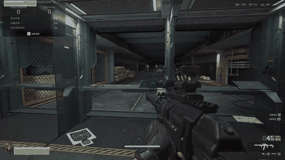

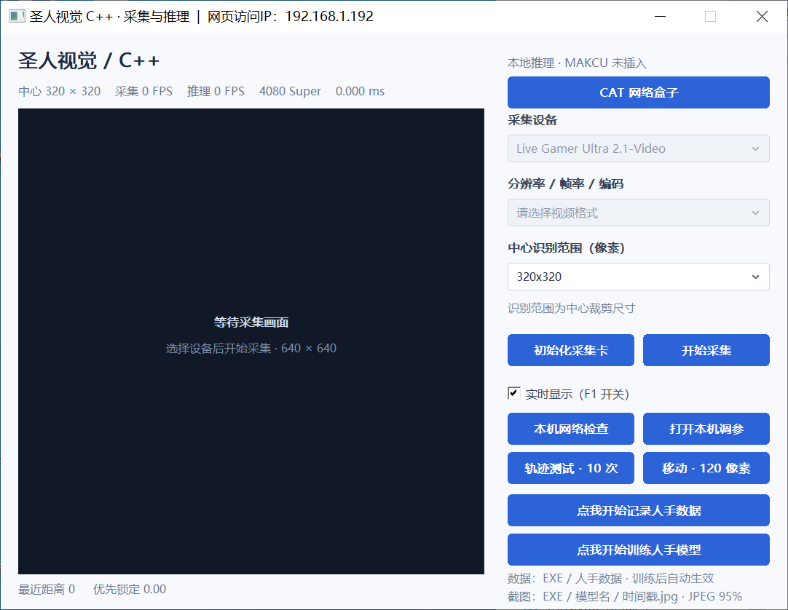
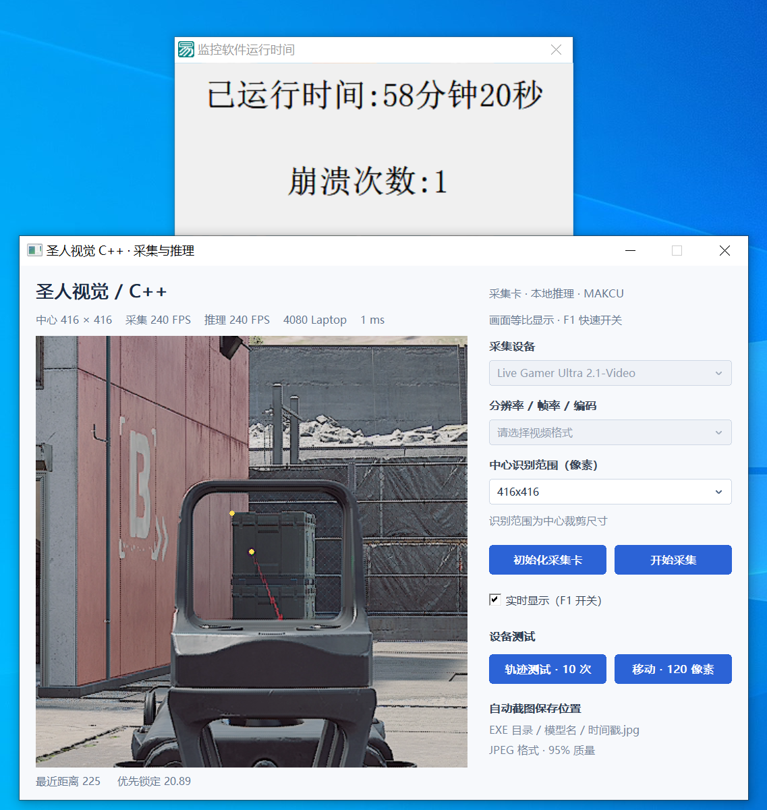
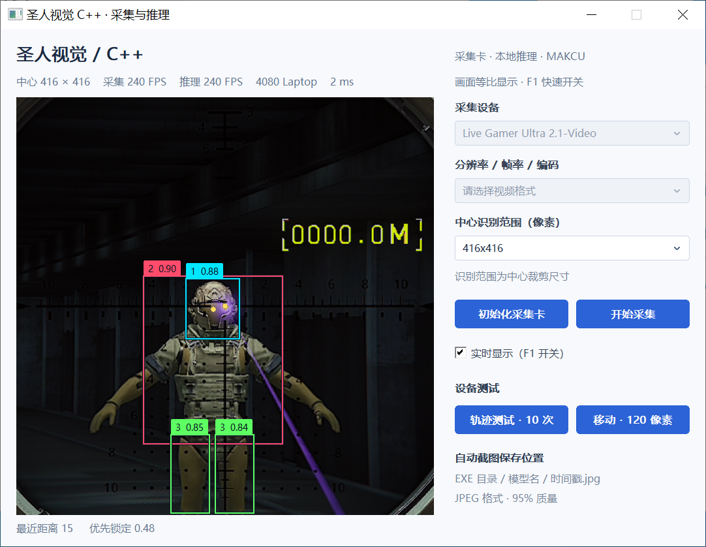
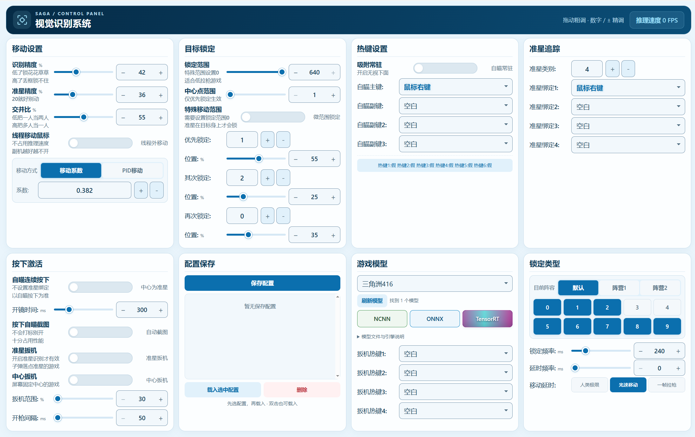
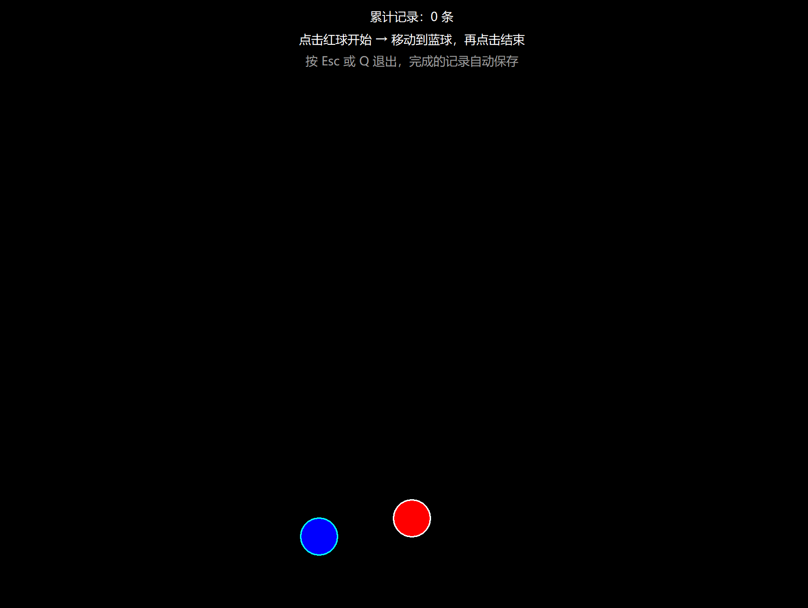

---

## 1. 30 秒构建

```powershell
cd D:\C++采集卡源码
./tools/build.ps1
```

构建后会自动把网页和运行时 DLL 拷到输出目录（`RuntimeDependencies.targets`，仅 x64 生效）：
NCNN、OpenCV、ONNXRuntime、DirectML 及 VC 运行库。
许可证同时复制到输出目录 `licenses`；CPU / DirectML 不需要 `onnxruntime_providers_shared.dll`，构建会清理旧输出中的该文件。

首次在另一台机器构建时，先准备依赖（ONNX Runtime 会从官方源码编译，耗时明显长于应用编译）：

```powershell
./tools/install_dependencies.ps1 -Python 'C:\你的Python目录\python.exe'
./tools/install_tensorrt.ps1
./tools/build.ps1
```

重新编译还需要 CUDA 13.4 Toolkit，并设置 `CUDA_PATH`（或构建属性 `SagaCudaDir`）。这属于开发环境要求；已有程序使用普通 NCNN / ONNX 时，不要求 NVIDIA 显卡或启动 N卡专用引擎。构建同时生成主程序和转换工具。

细节、依赖版本、排错见 **[docs/构建与部署.md](docs/构建与部署.md)**。

---

## 2. 运行需要什么（模型放入“模型数据”子目录）

| 文件 | 来源 | 说明 |
|---|---|---|
| CH343 串口驱动 | **已打进 EXE 资源** | Makcu 盒子（WCH CH343 USB 转串口）的驱动，检测到没装会自动静默安装，见下 |
| `DirectML.dll`、`ncnn.dll`、`onnxruntime.dll`、`opencv_world500.dll` | 随构建复制 | 缺一项启动时弹「缺少 …」并退出 |
| VC 运行库 `msvcp140*.dll`、`vcruntime140*.dll`、`vcomp140.dll` 等 | 随构建复制 | 工程用 `/MD` |
| `人手数据\mouse.bin`（兼容旧的 `mouse.bin`） | 主界面点击“点我开始记录人手数据”和“点我开始训练人手模型”生成 | 缺失时仍可进入界面采集训练；训练成功后自动替换并加载，无需重启。使用说明见 [人手轨迹\README.md](人手轨迹/README.md) |
| 红蓝球采集与 CPU 训练 | 已编入 EXE 的原生 C++ 功能 | 两个按钮直接使用，无需安装 Python、PyTorch 或其它训练环境 |
| `模型数据\<模型名>.param` + `模型数据\<模型名>.bin` | 用户自备 | NCNN 模型（`推理引擎=1`） |
| `模型数据\<模型名>.onnx` + `模型数据\空类别.txt` | 用户自备 | ONNX 模型（`推理引擎=2`，类别文件可选，无需模型目录写权限） |
| `模型数据\<模型名>.trt` | 本机 `ONNX转TRT工具.exe` 从原 ONNX 生成 | N卡专用推理（`推理引擎=3`）；支持范围见 TensorRT 使用说明 |
| TensorRT / CUDA 运行库 | 随构建复制 | 仅 N卡专用推理或转换工具使用，普通 NCNN / ONNX 路径不要求 NVIDIA 显卡 |
| `圣人自用.js` | 首次启动自动按默认值生成 | 全部配置键值对 |
| `主机IP.ini` | 旧版文件，新版不再读取或生成 | 启动不询问 IP；点击“打开本机调参”使用实际本机地址，局域网地址见“本机网络检查” |
| `圣人视觉识别系统.html` | 与 EXE 放在同一目录 | 使用外部网页文件；缺失时访问 IP 显示“网页不存在”，调参接口停用；补回文件后刷新恢复 |

启动及异常诊断统一写入 EXE 同目录的 UTF-8 `运行日志.txt`，排错时先查它。日志通过内存队列异步批量写入；超过 2000 行清理旧记录并保留最近 1000 行，同时限制在 1 MiB 内。正常推理、鼠标移动和按键不逐帧记录。详见 [日志与性能](docs/日志与性能.md)。
界面变量记忆写 `配置保存.ini`，配置快照/网页多配置写在 `配置保存\` 目录。成功开始采集后立即保存设备和格式，下次启动自动恢复采集；实时显示开关在切换时保存，启动不再强制开启或关闭。独立后台守护进程在异常退出后自动重启主程序，正常关闭和系统关机不会触发重启。旧版监控配置和按任意命令行参数启动采集的逻辑已移除。

“实时显示”下方的“全屏找图”默认关闭，切换后立即生效并记住选择。使用含 `640` 档的模型组时，勾选后最大搜索区域为屏幕中央的 **1920×640**：同一帧的中、左、右三个 640×640 区块分别使用 640 模型推理，再合并坐标。按住自瞄并且目标接近中心时，仍按原规则自动切换到较小模型；丢失目标或松开自瞄键后恢复宽范围。取消勾选后恢复原来的中心范围。宽范围每帧最多推理三次，因此耗时会增加；预览和网页显示实际识别宽高。

横向搜索不改变已有锁定范围设置。采集或 UDP 输入不足 1920 宽时仅覆盖实际输入的宽度，不放大画面；输入高度需至少 640。模型组缺少可用的 640 档时继续使用已有最大档的中心区域。单独选择一个模型时，勾选会以三个 640×640 区块输入该模型，没有模型组则不进行档位切换。

模型检查不等待采集首帧。文件缺失、模型加载失败或单模型推理报错时，弹出归属主窗口的置顶错误框，显示模型名、引擎、实际查找路径和原因，同时停止推理并清除旧结果。补齐文件后点“重试”即可重新加载；“取消”保持停止，也可在网页切换模型或引擎。主窗口和网页中的模型状态独立显示，采集启动成功只代表采集卡已出帧。

网页“热键设置”包含 1、2、3 三套配置，每套各有四个按键，并拥有独立的目标锁定排序、位置、锁定范围、中心点范围和微范围锁定设置。“目标锁定”随热键标签联动切换，不设独立切换按钮。标签只决定正在编辑哪套配置，三套按键始终同时监听；同键绑定或同时按下时按 1 > 2 > 3 选择，松开高优先组后自动回到仍按住的下一组。

移动设置在“移动系数”上方提供“X轴补偿幅度”和“Y轴补偿幅度”两个滑条（各 0–100，默认 0 关闭对应轴），三组热键独立保存。旧配置中的单个“移动速度补偿”自动迁移到两轴，已有轴值优先；两轴相同时保留原有效果。1–100 统一使用连续增强的预测追赶，所有非零档位均可沿运动方向越过当前锁定点，不再以 50 分段。预测距离由平滑跟随速度乘固定预测时间得到：匀速时趋于稳定，不随追踪时长累计；加减速时自动调整。追赶和原移动函数使用同一个预测点，避免越过实际点就反向拉回；建立有效预测后允许通过中心停移区。各类别锁定位置、人物关联、选靶和扳机仍采用实际检测，头身切换不把不同部位间距当作运动。完全丢失、松键、换人、配置/裁剪变化或过期帧清理历史。卡尔曼已移除；本功能不是已标定的真实人物速度或弹道预测，100 表示强度而不是固定领先 100 像素，不能保证任意系数与链路延迟下完全无抖动。

“吸附常驻”仅在第 1 套显示，开启后始终使用第 1 套。旧配置自动作为第 1 套，第 2、3 套首次继承它的目标参数、按键默认空白；此后各套独立保存，配置快照的保存和载入包含全部三套。

启动在后台预设当前程序的局域网防火墙规则，并验证本机 HTTP、网页文件和网络状态。
HTTP 首选 8888，端口冲突会自动回退；80 可用时支持直接访问 IP。局域网绑定被系统拒绝时尝试仅监听本机。
“本机网络检查”保留内存中的完整诊断报告；网络状态变化写入统一的 `运行日志.txt`，不影响主窗口启动。
本机自检通过不代表其他设备必然可达；路由器隔离、VPN 或系统管理策略等限制会按可检测范围提示。

### 关于那个 USB 串口驱动

Makcu 盒子用的是 WCH **CH343** 芯片，Windows 没有内置它的驱动，没装时枚举不到 COM 口。
本程序把驱动（WCH 官方 2.0.2025.03，WHQL 签名）以资源形式打包进 EXE。
先显示主界面，再在后台检查和连接；右上角显示 MAKCU 状态：

1. 串口已就绪时直接连接；未插盒子时跳过安装、硬件扫描和连接等待，已有驱动保持不变。
2. 只有发现受支持的设备、但串口不可用时，才从资源释放 9 个驱动文件和官方安装器，运行 `DRVSETUP64.exe /S`。
3. 必要时再执行 `pnputil /add-driver CH343SER.INF /install`
   → **`UpdateDriverForPlugAndPlayDevices` 强制装到当前在场的设备上**（官方安装器同款 API）
   → **重枚举设备节点**（`CM_Reenumerate_DevNode`）→ `pnputil /scan-devices`
   —— 重枚举这一步是关键：它等价于帮你拔插一次，所以**盒子不用拔插就能用**

驱动检查和修复报告统一写入 `运行日志.txt`，不再生成单独的驱动、串口或网络报告文件。
异常显示在右上角并记录日志，不用阻塞弹窗等待确认。启动日志包含毫秒计时，便于定位延迟。
如果启动时没插盒子，插入后重新启动即可连接；必要的安装和连接重试不会阻塞主界面。

**代价：安装驱动要管理员权限**，所以 EXE 清单声明了 `requireAdministrator` —— 双击时会弹一次系统 UAC。
详见 [docs\架构与源码索引.md](docs/架构与源码索引.md) 和 `src\DriverRes.rc` 顶部注释。

---

## 3. 目录结构

```
D:\C++采集卡源码
├── Saga.sln / SagaApp.vcxproj         主程序（Release|x64、Debug|x64）
├── TrtConverter.vcxproj               独立 ONNX 转 TRT 工具
├── Dependencies.props / dependencies.lock.json  SDK 路径、固定版本与来源校验
├── .deps\                            本地 SDK 与下载缓存（不入库）
├── RuntimeDependencies.targets        构建后自动复制网页和第三方 DLL
├── .gitignore / .gitattributes        入库规则：排除产物、DLL、模型、私有目录
├── src\                               全部源码（应用层 + 引擎层 + Makcu）
│   ├── 应用层：main / Ui / Util / Capture / Aim / Input / Net / DriverSetup / RuntimeLog
│   ├── drv\                           打进 EXE 的 CH343 驱动（INF/CAT/SYS/DLL）
│   ├── DriverRes.rc                   资源：驱动文件 + 提权清单
│   ├── app.manifest                   清单本体（requireAdministrator）
│   ├── 引擎层：OpnecvCapture / NCNN / ONNX / Mouse（原 Saga.dll）
│   ├── 头-only：App.h / Inference.h / AimLock.h / CapturePixels.h /
│   │            TensorPixels.h / NcnnPostprocess.h / FrameWait.h
│   ├── ONNX 侧：preprocessing.hpp detection.hpp nms.hpp session_base.hpp …
│   └── Makcu\                         串口协议 + CAT 网络键鼠 + 自带 asio
├── web\圣人视觉识别系统.html           网页控制面板（部署到 EXE 同目录，同源 API）
├── 人手轨迹\                          采集/训练说明与保留的 Python 参考脚本；EXE 使用 src 内的原生 C++ 实现
├── x64\Release\                       构建输出（EXE + PDB + 运行时 DLL + 配置，不入库）
├── docs\                              本文档与其配套文档
│   └── reference\                     GPU 型号表数据源（pci.ids 等）
└── .workbuddy\                        按需生成的隔离测试/依赖构建临时目录（可清理）
```

---

## 4. 文档索引

| 文档 | 看什么 |
|---|---|
| [docs/TensorRT使用说明.md](docs/TensorRT使用说明.md) | N卡专用引擎、模型转换、目录刷新与实测范围 |
| [docs/构建与部署.md](docs/构建与部署.md) | 环境、第三方库路径、编译开关、产物、部署、排错 |
| [docs/架构与源码索引.md](docs/架构与源码索引.md) | 模块职责、数据流、帧格式、线程表、锁约定 |
| [docs/配置与运行时接口.md](docs/配置与运行时接口.md) | `圣人自用.js` 键表、HTTP 接口、**网页端**与参数、UI 控件、ini 文件 |
| [docs/日志与性能.md](docs/日志与性能.md) | 运行日志内容、异步写入、自动清理和排错范围 |
| [docs/维护红线与已知问题.md](docs/维护红线与已知问题.md) | 行为约束、数值精度、并发和当前限制 |

---

## 5. 仓库包含 / 不包含什么（准备上传 GitHub）

**入库**：`README.md`、`docs\`（含 `reference\`）、`src\`、`tools\`（开发测试）、`web\`、`人手轨迹\`（说明与参考脚本，**不含个人采集数据**）、`Saga.sln`、`SagaApp.vcxproj`、
`TrtConverter.vcxproj`、`Dependencies.props`、`dependencies.lock.json`、`RuntimeDependencies.targets`、`.gitignore`、`.gitattributes`、`LICENSE`、`THIRD-PARTY-NOTICES.md`。

**不入库**（见 `.gitignore`）：

| 类别 | 内容 | 原因 |
|---|---|---|
| 构建产物 | `x64\Release\`、`*.obj/pdb/tlog/log`、VC 中间目录 | 可由源码重建 |
| 第三方 SDK / DLL | `.deps\`、ncnn / OpenCV / ONNXRuntime / DirectML / VC 运行库 | 按锁定版本准备，构建时自动复制 |
| **模型** | `*.onnx`、`*.param`、`*.bin`（含 NCNN 权重） | 体积大、非本仓库产出、可能涉及第三方授权 |
| 个人数据 | `mouse.bin`（人手轨迹）、`圣人自用.js`、`主机IP.ini`、`配置保存*`、`运行日志.txt` | 含个人 IP 与调参结果 |
| 私有辅助 | `.workbuddy\`（可重建的隔离测试输出）、`.vs\` | 非项目本体 |

克隆后要跑起来：先按 [docs/构建与部署.md](docs/构建与部署.md) 构建，将目标识别模型放到 EXE 旁的 `模型数据` 文件夹，构建会把 `web/圣人视觉识别系统.html` 自动复制到 EXE 同目录。构建和主程序启动会创建模型文件夹；旧版位于 EXE 根目录的识别模型需移入此文件夹。人手模型可通过记录、训练按钮生成，也可使用已有 `mouse.bin`；未提供配置文件时按默认值生成 `圣人自用.js`。

**注意**：第三方代码与数据的授权见 [THIRD-PARTY-NOTICES.md](THIRD-PARTY-NOTICES.md) ——
YOLOs-CPP 上游为 AGPL-3.0，MAKCU 上游为 GPL-3.0，参考许可证保留在 `docs/licenses`；Cat SDK 其余代码的原始授权仍未声明，沿用现有源码并记录来源状态。

---

## 6. 三条最容易踩的全局约定

1. **编码「内 GBK、外 UTF-8」**：全工程 `/source-charset:utf-8 /execution-charset:.936`。
   源码存 UTF-8，中文常量编成 GBK；`圣人自用.js`／HTTP 走 UTF-8（`ansiToUtf8` / `utf8ToAnsi` 转换）。
   文件路径独立使用 Unicode 宽字符，支持中文/特殊字符目录及长路径；INI 保存使用 UTF-16 LE。**不要改成 `/utf-8`**。
2. **不可省的三个开关**：`/arch:AVX2`（AVX2+FMA 内联指令）、`/EHsc`（Makcu 有 try/catch）、
   `/fp:fast`（数值路径，改了会出现 1 ULP 级差异）。
3. **几个硬性数值是用户明确要求保留的**：鼠标轨迹分段等待 **MAKCU 0.885 ms，CAT 无额外等待**、截图 **JPEG 质量 95**、
   截图节流 **80 ms**、单帧目标上限 **99**。详见「维护红线」。

---

## 7. 当前状态

- x64 Release 可构建；采集、推理、用户界面、HTTP、串口鼠标均已实机跑通。
- 尚未做「采集卡 → 推理 → 鼠标」端到端帧率实测：**不要把局部微基准的倍率外推成整机 FPS**。
- CAT 网络盒子已接入应用，使用 **CAT 1.2 UDP 协议**。盒子控制台须选择 `libcat_protocol_v1.2_udp.so` 并重启 CATBOX 服务；`libkm_protocol_v2.0_udp.so` 不适用于当前调用。CAT 在线时优先使用，离线时回退到可用的 MAKCU。连接及键盘设置见 [CAT 与 MAKCU 统一控制](docs/CAT与MAKCU统一控制.md)。
- 本仓库不含 UDP 发送端：双机模式下画面由外部采集机以 **1472 字节分包**发到本机 `:6666`。

---

## 完整演示（后续片段）

第 2 段：10–20.00 秒

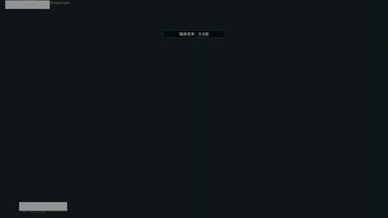

第 3 段：20–30.00 秒

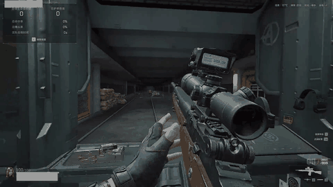

第 4 段：30–40.00 秒

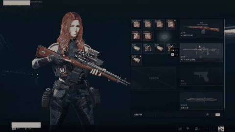

第 5 段：40–50.00 秒

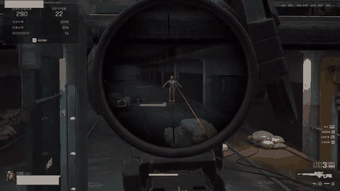

第 6 段：50–60.00 秒

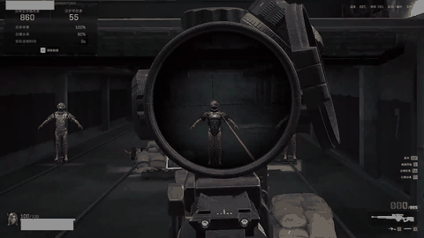

第 7 段：60–70.33 秒

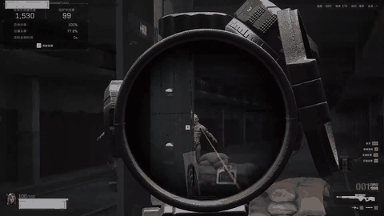
